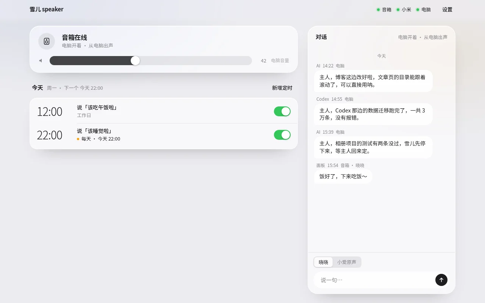
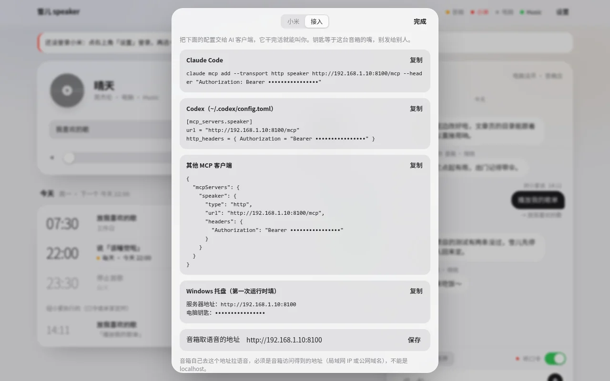

# 雪儿 speaker

**AI 干完活，让家里的小爱音箱叫你。** 在 WSL 或终端里跑 Claude Code、Codex 这类 AI 助手，任务一跑就是几分钟。人走开了，它做完、出错或者需要你拍板时，音箱会念一句，例如「博客那边改好了，可以直接用」。

不刷机，原生小爱的功能都还在。

## 能做什么

- **AI 叫你。** AI 客户端加上就有两个工具：`speaker_say`（念一句）和 `speaker`（看状态、调音量、勿扰、让小爱做事）。
- **调音量。** 半夜念之前调小，太小听不见就调大。
- **勿扰。** 交代完任务去睡觉，AI 打开勿扰；夜里做完的事照样记着，不出声；你回来时它关掉，告诉你攒了几句。
- **让小爱做事。** 「明天早上八点叫我」「十分钟后提醒我关火」「把客厅灯关了」，AI 替你跟小爱说。只用于闹钟、提醒、查信息和家里的设备，买东西、付款、打电话、发消息一律拒绝。
- **不吵。** 同一句话 10 秒内不重复念，一分钟最多 6 句。

## 两种用法

| | 直接用（推荐先试） | 放在服务里跑 |
| --- | --- | --- |
| 要装什么 | 一个程序，几 MB | Docker，和音箱在同一个局域网、一直开着 |
| 声音 | 小爱原声 | 「晓晓」音色（不行时换小爱原声） |
| 多出来的 | — | 网页面板、定时、电脑开着时从电脑出声、给脚本用的 `/v1/say`、接 Husic 放歌 |

先直接用，觉得原声不够好听、想要面板，再换成服务。两种用法的 AI 工具一模一样。

## 直接用：三步

**1. 装程序**

```bash
curl -fsSL https://raw.githubusercontent.com/hardware661/xueer-speaker/master/install.sh | sh
```

Windows 到 [Releases](https://github.com/hardware661/xueer-speaker/releases) 下载 `xueer-speaker-windows-amd64.exe`，改名成 `xueer-speaker.exe`。

**2. 登录小米**

```bash
xueer-speaker login     # 输入音箱绑定的小米账号、密码；收到短信验证码就填；账号下有几台音箱就选一台
xueer-speaker test      # 自检：一步一步试，最后让小爱念一句
```

登录信息存在 `~/.config/xueer-speaker/`（Windows 是 `%AppData%\xueer-speaker\`），只在你自己的电脑上。

**3. 交给 AI**

```bash
claude mcp add speaker -- xueer-speaker mcp          # Claude Code
```

Codex（`~/.codex/config.toml`）：

```toml
[mcp_servers.speaker]
command = "xueer-speaker"
args = ["mcp"]
```

然后在给 AI 的规则里（如 `CLAUDE.md`、`AGENTS.md`）加两句：

```
每次回复我之前调用一次 speaker_say，说清是哪个项目、结果怎样。
我说要去睡觉时用 speaker 打开勿扰（到我说的起床时间）；我回来说话时先关掉勿扰再汇报。
```

工具说明里已经写好了怎么说话：先说项目、再说结果，坏消息直说，80 字以内。

**命令行也能直接用：**

| 命令 | 做什么 |
| --- | --- |
| `xueer-speaker say 做好了` | 念一句 |
| `xueer-speaker volume` / `volume 40` | 读 / 设音量 |
| `xueer-speaker do 明天八点叫我` | 让小爱做事（加 `--silent` 做完不出声） |
| `xueer-speaker dnd on --until 08:00` / `dnd off` | 勿扰 |
| `xueer-speaker status` | 登录、音箱、音量、勿扰 |
| `xueer-speaker test` | 自检 |

## 放在服务里跑

想要晓晓的声音和网页面板时用。需要一台和音箱在**同一个局域网**、一直开着的机器（NAS、旧电脑、树莓派都行），装好 Docker：

```bash
git clone https://github.com/hardware661/xueer-speaker.git && cd xueer-speaker
docker compose up -d
docker compose logs speaker | grep setup_code   # 记下 6 位初始化码
```

1. 用手机或电脑打开 `http://<这台机器的局域网 IP>:8100`，填初始化码，设一个面板密码。
2. 在「设置 → 小米」登录音箱绑定的小米账号，收到短信验证码就填进去，选一台音箱，点「测试一下」。
3. 在「设置 → 接入」复制配置，交给你的 AI 客户端。

> 第一次打开面板时请用局域网 IP 访问，不要用 `localhost`：晓晓的语音要让音箱按这个地址来取。地址不对的话，在「设置 → 接入」最下面改。

为什么要同一个局域网：晓晓的声音是在服务里生成的音频，要让音箱自己来取；小爱原声不用取文件，所以直接用就不需要这些。



面板顶上的「勿扰」点一下就能开关。



面板「设置 → 接入」里的配置已经带好地址和钥匙，大概长这样：

```bash
claude mcp add --transport http speaker http://192.168.1.10:8100/mcp --header "Authorization: Bearer <钥匙>"
```

```toml
[mcp_servers.speaker]
url = "http://192.168.1.10:8100/mcp"
http_headers = { Authorization = "Bearer <钥匙>" }
```

只支持 stdio 的 MCP 客户端，可以用程序自带的转发：`xueer-speaker mcp-local -url http://…/mcp -key-file ~/.speaker.key`（钥匙文件权限要是 600）。

## 进阶（可选）

下面几项要「放在服务里跑」，都不影响基本用法，用得上再配。

### 让脚本说话

`/v1/say` 在 8101 端口上，默认只有这台机器能访问。钥匙在面板「设置 → 接入」的配置里，也可以在数据卷的 `keys.json` 里找到 `bot` 那一项：

```bash
curl -H "Authorization: Bearer <bot 钥匙>" -H "Content-Type: application/json" \
  -d '{"text":"主人，备份做完了","source":"backup"}' http://127.0.0.1:8101/v1/say
```

返回 `202` 表示已经排上队。太长（超过 80 字）返回 `400`，说得太频繁返回 `429`。

### 电脑开着时从电脑出声（Windows 托盘）

电脑平时用蓝牙连着音箱的话，音箱正在放电脑的声音时念不了话，会打断你在听的歌。装上托盘，电脑开着时播报改从电脑放，声音照样经蓝牙从音箱出来；电脑关着，音箱自己念。

1. 在 [Releases](https://github.com/hardware661/xueer-speaker/releases) 下载 `xueer-speaker-windows-x64-*.zip`，解压到 `%LOCALAPPDATA%\xueer-speaker`。
2. 运行 `XueerSpeaker.exe`，填服务器地址和电脑钥匙（面板「设置 → 接入」最后一块）。
3. 托盘图标变黑就是连上了。右键菜单里可以开机自启、暂停电脑播报、改连接。

需要 Windows 10/11 和 Microsoft Edge WebView2（Windows 11 自带）。

### 喊一句放歌（接 Husic）

1. 给 Husic 开一个服务钥匙：启动 Husic 时加 `HUSIC_SERVICE_KEY_FILE=/path/to/service.key`（见 Husic 的部署文档）。
2. 把同一个钥匙文件放进 speaker 能读到的地方，在 `.env` 里写：

   ```
   XS_HUSIC=http://husic:18788
   XS_HUSIC_KEY=/data/husic.key
   ```

3. `docker compose up -d` 重建。面板顶上出现 Husic 灯，就能放歌了。

音箱只能放网易云的 mp3，所以只会放 Husic 里有网易云来源的歌。

## 设置

所有设置都可以写在 `.env` 里（参考 `.env.example`），也可以作为 `serve` 的参数。`xueer-speaker serve -h` 能列出全部。

| 环境变量 | 默认 | 作用 |
| --- | --- | --- |
| `XS_BASE` | 第一次打开面板的地址 | 音箱取语音的地址，必须是音箱访问得到的 |
| `XS_SPEAKER` | 面板里选 | 账号下有好几台音箱时用哪台（名字、did 或 MAC） |
| `XS_PERSONA` / `XS_OWNER` | `雪儿` / `主人` | AI 说话时的名字和对你的称呼 |
| `TZ` | `Asia/Shanghai` | 定时用的时区 |
| `XS_HUSIC` / `XS_HUSIC_KEY` | 不接 | Husic 地址和服务钥匙文件 |
| `XS_REMINDERS` | 不接 | 面板要列出的提醒来源（GET 返回 `[{"at":"…","text":"…"}]`） |
| `XS_AUTH` | `password` | 改成 `header`：前面的反向代理负责登录，并设置 `X-Owner-User` |

数据全部在 `speaker-data` 卷里：`speaker.db`（说过的话、定时，保留 30 天）、`keys.json`（各种钥匙）、`xiaomi.json`（小米登录）。备份就备份这个卷。

## 放到服务器上

音箱要能访问到 speaker 的地址，所以最简单的部署就是放在家里。如果放在公网服务器上：

- 前面加一层 HTTPS 反向代理（Caddy、nginx），`XS_BASE` 写 `https://你的域名`。
- `/a/` 是音箱取语音的路径，音箱不会带登录信息，**不要给它加登录**。链接本身是 32 字节随机串，几分钟后就失效。
- 面板自带密码登录。如果反向代理已经有统一登录，可以设 `XS_AUTH=header`，由代理设置 `X-Owner-User`。**代理一定要清掉客户端自己带来的这个头**，否则任何人都能进面板。

## 支持的音箱

带小爱同学的小米 / Redmi 智能音箱一般都能用。实测的是 **Xiaomi 智能音箱 Pro（OH2P）**；用别的型号遇到念不出来的情况，欢迎在 Issue 里说一声型号。

## 常见问题

**连上了，但是没声音？** 直接用就跑 `xueer-speaker test`，服务就点面板里的「测试一下」，它会一步一步告诉你卡在哪：没登录、找不到音箱、小爱没念出来，还是音箱取不到晓晓的语音。

**收不到验证码 / 提示「小米暂时限流」？** 短时间内登录太多次会被小米限流，等两小时再试。建议专门开一个小米小号，把音箱共享给它。

**面板显示音箱在线，但没有声音？** 多半是音箱取不到语音：看「设置 → 接入」最下面的地址，用手机连上同一个 Wi-Fi，打开这个地址能看到面板才算对。

**念到一半被打断？** 电脑在通过蓝牙往音箱放声音时，音箱念不了。装上 Windows 托盘，让播报从电脑出。

**AI 每次都要调用，会很吵吗？** 同一句话 10 秒内只念一次，一分钟最多 6 句。睡觉时让 AI 开勿扰，或者自己 `xueer-speaker dnd on`、点面板上的「勿扰」。

**「让小爱做事」安全吗？** 它等于 AI 替你跟小爱说一句话。程序会拒绝含「买、下单、付款、支付、转账、充值、打电话、发短信、发消息、发微信、视频通话」的句子；小爱绑了支付或通讯服务的话，也建议在米家里关掉语音购物和语音通话。

## 排障命令

这些直接连小米，排查问题时用（服务在跑时少用，免得被小米限流）：

| 命令 | 做什么 |
| --- | --- |
| `xueer-speaker devices` | 列出账号下的音箱 |
| `xueer-speaker conversations -n 5` | 小爱最近听到的话 |
| `xueer-speaker action <siid> <aiid> '[参数]'` | 发一条 MIoT 动作，如 `action 7 3 '["你好"]'` |
| `xueer-speaker getprop <siid> <piid>` | 读一个 MIoT 属性，如 `getprop 2 1` 读音量 |
| `xueer-speaker ubus <path> <method> '{}'` | 直接调音箱的 ubus |

`siid`、`aiid`、`piid` 去 [米家规格书](https://home.miot-spec.com/) 搜你的型号（如 `xiaomi.wifispeaker.oh2p`）。在服务里跑就加 `docker compose exec speaker` 前缀。

## 开发

```bash
go test -race ./...                       # 全部测试，用假的小米云，不碰真机
go run ./cmd/xueer-speaker serve -data ./data -cache ./data/cache -edge-tts edge-tts
```

需要 Go 1.25，本机要装 `edge-tts`（`pip install edge-tts`）。Windows 托盘的构建见 [`pc/README.md`](pc/README.md)。代码结构和约定见 [CONTRIBUTING.md](CONTRIBUTING.md)。

## 参考

小米接口的用法参考了这些项目（没有复制代码）：

- [MiService](https://github.com/yihong0618/MiService)：MIoT 签名、MiNA 接口
- [xiaomusic](https://github.com/hanxi/xiaomusic)：`player_play_music` 的参数和各型号的差别
- [migpt-next](https://github.com/idootop/migpt-next)：对话记录接口
- [hass-xiaomi-miot](https://github.com/al-one/hass-xiaomi-miot) PR #2970：推送后把循环模式设为 2，音箱只念一遍，念完把声音还给蓝牙

## 许可

[MIT](LICENSE)。第三方组件的许可见 [THIRD_PARTY_NOTICES.md](THIRD_PARTY_NOTICES.md)。

本项目和小米公司没有关系。「小爱同学」「Xiaomi」是小米的商标。用到的小米接口没有公开文档，小米随时可能修改。
